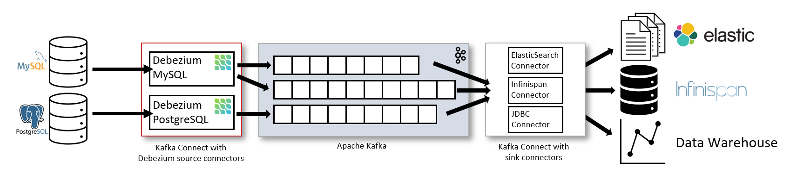

# Debezium

## Architecture



- **Source**: Debezium connectors (MySQL, PostgreSQL, ...) run on Kafka Connect and read the database change log (binlog/WAL).
- **Kafka**: each table is written to its own topic.
- **Sink**: sink connectors (Elasticsearch, Infinispan, JDBC, ...) read from the topics and write to the target systems.

## Kubernetes (Strimzi)

Debezium runs as connector plugins on a Kafka Connect cluster (Strimzi), deployed with the Helm chart [kafka-connect](../kafka-connect/).

- `KafkaConnect`: the worker cluster, bundled with the Debezium plugins (MySQL, PostgreSQL, Oracle, SQL Server, JDBC sink).
- `KafkaConnector`: each connector is a CR, declared under the `debezium` key in `values.yaml` (requires `connect.useConnectorResources: true`).

### 1. Declare a connector

Example PostgreSQL source connector in `kafka-connect/values.yaml`:

```yaml
debezium:
  - name: postgres-source
    enabled: true
    class: io.debezium.connector.postgresql.PostgresConnector
    tasksMax: 1 # Debezium source connectors use a single task
    state: running # running | paused | stopped
    autoRestart:
      enabled: true
      maxRestarts: 10
    config:
      database.hostname: ${secrets:postgres:host}
      database.port: 5432
      database.user: ${secrets:postgres:username}
      database.password: ${secrets:postgres:password}
      database.dbname: app
      topic.prefix: cdc.postgres # topic: <prefix>.<schema>.<table>
      plugin.name: pgoutput
      slot.name: debezium_app
      publication.autocreate.mode: filtered
      table.include.list: public.tbl1,public.tbl2
      snapshot.mode: initial
```

`connector.class` per database:

| Database   | class                                                |
| ---------- | ---------------------------------------------------- |
| PostgreSQL | `io.debezium.connector.postgresql.PostgresConnector` |
| MySQL      | `io.debezium.connector.mysql.MySqlConnector`         |
| Oracle     | `io.debezium.connector.oracle.OracleConnector`       |
| SQL Server | `io.debezium.connector.sqlserver.SqlServerConnector` |

Database preparation guides: [MYSQL](../kafka-connect/docs/MYSQL.md), [ORACLE](../kafka-connect/docs/ORACLE.md), [SQL_SERVER](../kafka-connect/docs/SQL_SERVER.md).

> Never put credentials in plain text: use the config providers `${secrets:<secret>:<key>}`, `${configmaps:<cm>:<key>}` or `${env:<VAR>}` (enabled in `connect.config.config.providers`).

### 2. Deploy

```shell
helm upgrade --install kafka-connect ./kafka-connect -n kafka -f kafka-connect/values.yaml
```

### 3. Check status

```shell
kubectl get kafkaconnect,kafkaconnector -n kafka
kubectl describe kafkaconnector <name> -n kafka
kubectl get kafkatopic -n kafka | grep cdc.
```

### 4. Operations

Restart a connector (run once):

```shell
kubectl annotate kafkaconnector <name> -n kafka strimzi.io/restart="true"
```

Restart a failed task:

```shell
kubectl annotate kafkaconnector <name> -n kafka strimzi.io/restart-task="0"
```

Pause / stop: set `state` to `paused` or `stopped`, then run `helm upgrade`.

Reset offsets (the connector must be `stopped` first) by adding this annotation to the connector:

```yaml
annotations:
  strimzi.io/connector-offsets: reset
```

## Docker

Run Kafka and Kafka Connect locally with the official Debezium image, then manage connectors through the Kafka Connect REST API.

### 1. Start the stack

`docker-compose.yaml`:

```yaml
services:
  kafka:
    image: apache/kafka:4.1.0
    ports:
      - "9092:9092"
    environment:
      KAFKA_NODE_ID: 1
      KAFKA_PROCESS_ROLES: broker,controller
      KAFKA_LISTENERS: PLAINTEXT://:9092,CONTROLLER://:9093
      KAFKA_ADVERTISED_LISTENERS: PLAINTEXT://kafka:9092
      KAFKA_CONTROLLER_LISTENER_NAMES: CONTROLLER
      KAFKA_CONTROLLER_QUORUM_VOTERS: 1@kafka:9093
      KAFKA_OFFSETS_TOPIC_REPLICATION_FACTOR: 1

  connect:
    image: quay.io/debezium/connect:3.7
    depends_on:
      - kafka
    ports:
      - "8083:8083"
    environment:
      BOOTSTRAP_SERVERS: kafka:9092
      GROUP_ID: connect-cluster
      CONFIG_STORAGE_TOPIC: connect_configs
      OFFSET_STORAGE_TOPIC: connect_offsets
      STATUS_STORAGE_TOPIC: connect_statuses
```

```shell
docker compose up -d
curl -s localhost:8083/connector-plugins   # list installed plugins
```

The `quay.io/debezium/connect` image already bundles the MySQL, PostgreSQL, Oracle, SQL Server and JDBC connectors.

### 2. Register a connector

`postgres-source.json`:

```json
{
  "name": "postgres-source",
  "config": {
    "connector.class": "io.debezium.connector.postgresql.PostgresConnector",
    "tasks.max": "1",
    "database.hostname": "postgres",
    "database.port": "5432",
    "database.user": "debezium",
    "database.password": "debezium",
    "database.dbname": "app",
    "topic.prefix": "cdc.postgres",
    "plugin.name": "pgoutput",
    "slot.name": "debezium_app",
    "publication.autocreate.mode": "filtered",
    "table.include.list": "public.tbl1,public.tbl2",
    "snapshot.mode": "initial"
  }
}
```

```shell
curl -X POST -H "Content-Type: application/json" --data @postgres-source.json localhost:8083/connectors
```

### 3. Check status

```shell
curl -s localhost:8083/connectors
curl -s localhost:8083/connectors/postgres-source/status
docker compose exec kafka /opt/kafka/bin/kafka-topics.sh --bootstrap-server kafka:9092 --list
```

### 4. Operations

```shell
# update config
curl -X PUT -H "Content-Type: application/json" --data @config.json localhost:8083/connectors/postgres-source/config
# restart connector and failed tasks
curl -X POST "localhost:8083/connectors/postgres-source/restart?includeTasks=true&onlyFailed=true"
# pause / resume / stop
curl -X PUT localhost:8083/connectors/postgres-source/pause
curl -X PUT localhost:8083/connectors/postgres-source/resume
curl -X PUT localhost:8083/connectors/postgres-source/stop
# reset offsets (connector must be stopped first)
curl -X DELETE localhost:8083/connectors/postgres-source/offsets
# delete
curl -X DELETE localhost:8083/connectors/postgres-source
```

# References

- [Architecture](https://debezium.io/documentation/reference/3.7/architecture.html)
- [Kafka Connect](https://debezium.io/documentation/reference/3.7/kc-tutorial.html)
